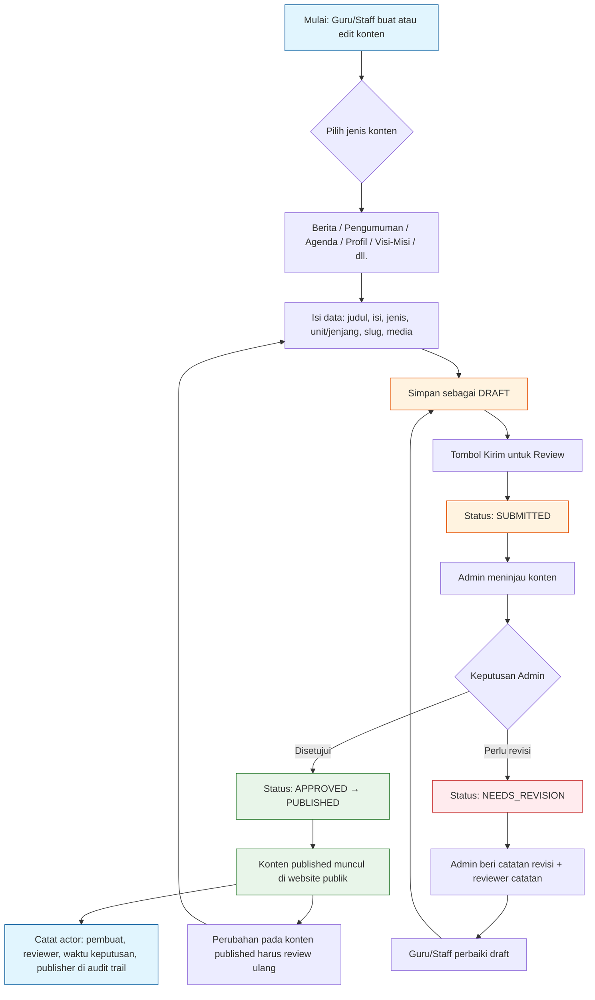
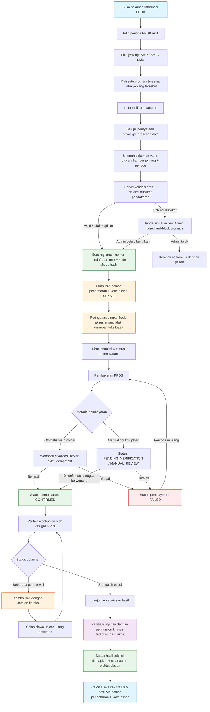
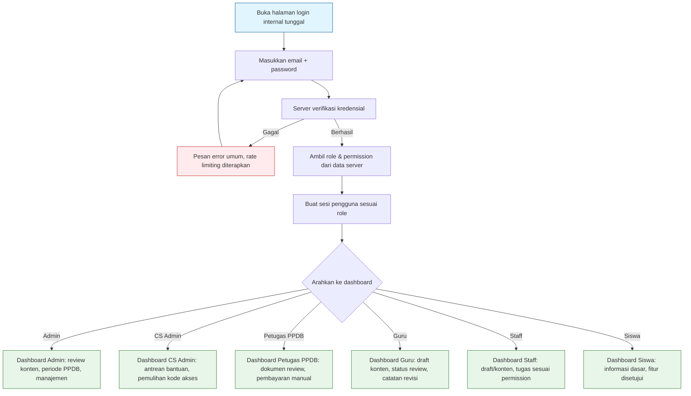
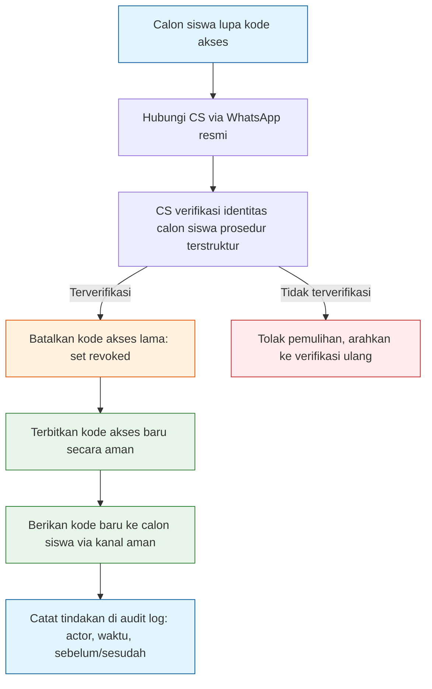
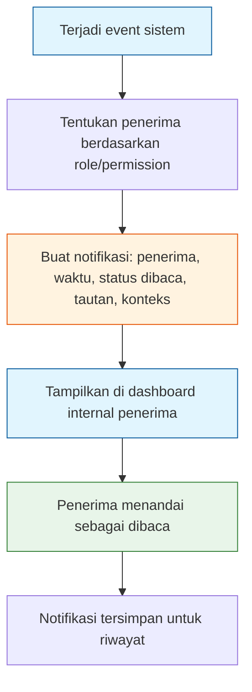

# Flowchart Alur Sistem — Website Sekolah DMR + PPDB Online (Revisi)

**Dokumen acuan:** `PRD_Website_DMR_OpenCode.md` bab 12.1  
**Status:** Rancangan revisi (BELUM diimplementasikan, BELUM dibuat migration)  
**Notasi:** Mermaid `flowchart`  
**Perhatian:** Ini adalah DOCUMENT, bukan kode. Tidak ada migration atau controller yang dibuat dari dokumen ini.

---

## 1. Alur CMS (Konten)

Pengguna: Guru / Staff → Admin → Publik



### Penjelasan langkah CMS:
1. Guru/Staff membuat konten baru atau mengedit yang ada.
2. Konten disimpan sebagai `draft` — **tidak terlihat publik**.
3. Pengguna mengirim draft untuk review → status berubah ke `submitted`.
4. Admin meninjau isi, media, kategori, jenjang, dan informasi publik.
5. Admin menyetujui → `published` (muncul di publik), atau mengembalikan → `needs_revision` dengan catatan.
6. Guru/Staff memperbaiki dan mengirim ulang.
7. Konten yang sudah `published` jika diubah kembali harus melalui alur review Admin.
8. Audit trail mencatat: pembuat, waktu perubahan, reviewer, waktu keputusan, publisher, dan status sebelum/sesudah.

---

## 2. Alur PPDB (Calon Siswa) — SMP, SMA, SMK

Pengguna: Calon siswa (tidak perlu akun internal) → Petugas PPDB → Panitia/Pimpinan



### Penjelasan langkah PPDB:
- Periode PPDB dapat mencakup SMP, SMA, dan SMK sekaligus, atau per jenjang (dikonfigurasi Admin).
- Calon siswa memilih **satu jenjang dan satu program** dalam satu periode.
- **Pencegahan duplikat pendaftaran** dilakukan di application layer (cek kombinasi identitas + periode), tidak melalui unique constraint yang berisiko menolak calon siswa berbeda yang secara kebetulan memiliki data identitas mirip.
- Nomor pendaftaran dan kode akses hanya ditampilkan sekali setelah pendaftaran berhasil dibuat. Kode akses disimpan sebagai **hash**, bukan teks biasa.
- Status pembayaran, dokumen, dan hasil seleksi adalah tiga status terpisah.
- Pembayaran otomatis hanya dikonfirmasi dari webhook provider yang divalidasi signature; bukti upload tidak otomatis melunasi.
- Pembayaran manual memerlukan tindakan role berwenang dan audit log.
- Percobaan ulang pembayaran (retry) didukung: transaksi gagal dapat menghasilkan pembayaran baru untuk registrasi yang sama.
- Hasil seleksi hanya dapat ditetapkan panitia/pimpinan dengan permission khusus.

---

## 3. Alur Pembayaran (Hybrid Verification + Retry)

```mermaid
flowchart TD
    A[Calon siswa selesai formulir + dapat nomor pendaftaran] --> B[Instruksi pembayaran ditampilkan]
    B --> C{Provider pembayaran aktif?}
    C -->|Ya| D[Buat transaksi pembayaran baru / attempt baru]
    D --> E[Calon siswa membayar melalui provider]
    E --> F[Provider kirim webhook/callback]
    F --> G[Validasi signature webhook server-side]
    G -->|Valid + idempotent (provider_event_id sudah diproses)| H[Update status: CONFIRMED]
    G -->|Duplikat webhook| I[Abaikan, tidak membuat transaksi ganda]
    G -->|Invalid| J[Tandai MANUAL_REVIEW]
    C -->|Tidak aktif / gagal / pengecualian| J
    J --> K[Petugas berwenang periksa bukti transfer]
    K --> L{Setiap?}
    L -->|Ya| M[Konfirmasi manual: CONFIRMED + audit log + actor]
    L -->|Tidak| N[Tolak: FAILED + alasan + catat actor]
    N -->|Calon siswa ingin coba lagi| O[Buat payment attempt baru untuk registrasi sama]
    O --> D
    M --> P[Registrasi dapat melanjutkan verifikasi dokumen]
    P --> Q[Status dokumen dipisah dari status pembayaran]

    style A fill:#e1f5fe,stroke:#01579b
    style H fill:#e8f5e9,stroke:#2e7d32
    style I fill:#e1f5fe,stroke:#01579b
    style J fill:#fff3e0,stroke:#e65100
    style M fill:#e8f5e9,stroke:#2e7d32
    style N fill:#ffebee,stroke:#c62828
    style O fill:#fff3e0,stroke:#e65100
    style P fill:#e8f5e9,stroke:#2e7d32
    style Q fill:#e1f5fe,stroke:#01579b
```

### Persyaratan teknis pembayaran:
- Webhook divalidasi dengan signature atau mekanisme resmi provider — **jangan percaya query string/browser**.
- Idempotency: `payment_events.provider_event_id` digunakan untuk mencegah pemrosesan webhook duplikat.
- Percobaan ulang (retry): satu registrasi dapat memiliki beberapa pembayaran (attempt), yang aktif/latest digunakan.
- Simpan: referensi transaksi, jumlah, mata uang, status, timestamp, jejak perubahan.
- Jangan simpan data kartu/kredensial sensitif.
- Jika provider belum dipilih: interface/kontrak + implementasi manual yang aman.
- Status pembayaran **tidak** bergantung pada status dokumen atau hasil seleksi.

---

## 4. Alur Login Internal (Satu Pintu)

Pengguna: Admin, CS Admin, Guru, Staff, Siswa



### Prinsip:
- Satu halaman login untuk semua role internal.
- Role **tidak** diandalkan dari input pengguna; berasal dari data server (database/role/permission).
- Setelah autentikasi, redirect ke dashboard sesuai role/permission.
- Tidak ada login terpisah untuk calon siswa PPDB (mereka menggunakan nomor pendaftaran + kode akses di halaman status publik).

---

## 5. Alur Pemulihan Kode Akses (Calon Siswa)



### Prinsip keamanan:
- Jangan pernah menampilkan atau mengirim kembali kode lama dalam bentuk teks biasa.
- Kode lama dicatat sebagai `revoked`, kode baru terbitkan, tindakan dicatat audit log.
- Pertanyaan verifikasi identitas ditentukan sekolah, jangan gunakan informasi mudah ditebak sebagai satu-satunya faktor.

---

## 6. Alur Notifikasi Internal



### Contoh pemicu notifikasi:
- Draft dikirim untuk review (penerima: Admin).
- Konten dikembalikan revisi atau dipublikasikan (penerima: Guru/Staff pembuat).
- Dokumen PPDB baru diunggah atau perlu koreksi (penerima: Petugas PPDB).
- Pembayaran perlu pemeriksaan manual atau berubah status (penerima: Admin/Petugas PPDB).
- Periode PPDB mendekati tanggal (jika fitur pengingat disetujui).

**Tidak ada kode akses atau dokumen sensitif dalam isi notifikasi.**

---

## 7. Catatan Implementasi (Revisi)

- Semua flowchart di atas akan direalisasikan sebagai route, controller, model, dan migration setelah ERD disetujui.
- Validasi server diutamakan; frontend hanya sebagai bantuan UX.
- Setiap transisi status sensitif (publish, konfirmasi pembayaran, keputusan hasil, reset kode akses) harus dicatat di `audit_logs`.
- Rate limiting diterapkan pada login internal, pemeriksaan status PPDB, dan pemulihan kode akses.
- Pencegahan duplikat pendaftaran: application-level check pada (ppdb_period_id + fingerprint identitas), tidak hard unique constraint yang berisiko.