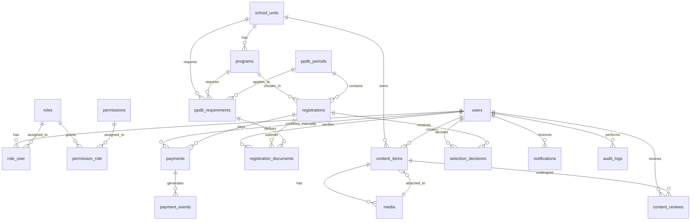

# ERD (Entity Relationship Diagram) — Website Sekolah DMR + PPDB Online (Revisi)

**Dokumen acuan:** `PRD_Website_DMR_OpenCode.md` bab 12.2  
**Status:** Rancangan revisi (BELUM disetujui, BELUM dibuat migration)  
**Notasi:** Mermaid `erDiagram`  
**Perhatian:** Dokumen ini harus ditinjui dan disetujui pengguna sebelum migration/schema final ditulis.  
**Perubahan utama revisi:** periode PPDB mandiri (tidak terikat paksa satu jenjang), pembayaran mendukung percobaan ulang, pencegahan duplikat tanpa unique constraint berisiko, media publik/privat, dan pencatatan actor yang konsisten.

---

## 1. Daftar Entitas dan Alasan Kebutuhan (Revisi)

| # | Entitas | Alasan Kebutuhan (dari PRD) |
|---|---------|------------------------------|
| 1 | `users` | Akun internal untuk Admin, CS Admin, Petugas PPDB, Guru, Staff, Siswa (login satu pintu). Digunakan kembali migration bawaan Laravel. |
| 2 | `roles` | Hak akses per role (least privilege). Role berasal dari data server, bukan input user. |
| 3 | `permissions` | Izin spesifik (mis. `manage_ppdb`, `publish_content`, `verify_payment`, `set_selection_result`). |
| 4 | `role_user` | Pivot banyak-ke-banyak antara users dan roles. |
| 5 | `permission_role` | Pivot banyak-ke-banyak antara roles dan permissions. |
| 6 | `school_units` | Jenjang sekolah: SMP, SMA, SMK (satu yayasan, tiga unit). |
| 7 | `programs` | Program/jurusan per unit (contoh: SMK Otomotif dan PPLG). Terkait satu school_unit. |
| 8 | `content_items` | Konten CMS terpadu: berita, pengumuman, agenda, profil, visi-misi, dll. dengan status publikasi dan actor tracking. |
| 9 | `content_reviews` | Riwayat review/revisi konten oleh Admin (pembuat, reviewer, waktu, catatan, keputusan, status sebelum/sesudah). |
| 10 | `media` | Metadata file yang diunggah. **storage_visibility** (public/private), **disk**, nama file aman. Foto publik vs dokumen PPDB privat. |
| 11 | `ppdb_periods` | Periode PPDB mandiri (tidak terikat paksa satu school_unit). Cakupan SMP/SMA/SMK ditetapkan Admin. Biaya pendaftaran dikonfigurasi di sini. |
| 12 | `ppdb_requirements` | Daftar dokumen wajib per periode + school_unit (+ program opsional). |
| 13 | `registrations` | Data pendaftaran calon siswa: nomor pendaftaran, kode akses hash, periode, jenjang, program, status utama. **registration_fingerprint** (indexed, tidak unique) untuk deteksi duplikat application-level. **access_code_revoked_at** untuk pemulihan kode. |
| 14 | `registration_documents` | File dokumen per pendaftaran: jenis, versi, status, catatan koreksi, pemeriksa, waktu. |
| 15 | `payments` | Transaksi pembayaran PPDB. **registration_id TIDAK unique** (boleh banyak attempt/percobaan ulang). attempt_number, is_active, failure_reason. Status terpisah dari dokumen dan hasil. |
| 16 | `payment_events` | Event/webhook riwayat untuk idempotency dan audit pembayaran. provider_event_id unique. |
| 17 | `selection_decisions` | Keputusan hasil akhir seleksi oleh otoritas berwenang: waktu, alasan, catatan, actor, status sebelum/sesudah. |
| 18 | `notifications` | Notifikasi internal: penerima, waktu, status dibaca, tautan, konteks. Tanpa kode akses/dokumen sensitif. |
| 19 | `audit_logs` | Jejak aktivitas sensitif: perubahan role/permission, publikasi konten, review dokumen, pembayaran manual, perubahan hasil, reset kode akses. Tanpa menyimpan secret. |

**Entitas yang sengaja tidak dibuat di versi awal** (di luar scope PRD bab 3.2): nilai, absensi, jadwal, e-learning, SPP, alumni portal, live chat, global search.

**Migration bawaan Laravel yang DIGUNAKAN KEMBALI (tidak dibuat ulang):**
- `users` (sudah ada)
- `password_reset_tokens` (sudah ada)
- `sessions` (sudah ada)
- `cache` (sudah ada)
- `jobs` (sudah ada)

---

## 2. ERD Mermaid (Revisi)

---

## 3. Atribut Inti per Entitas (Revisi)

### 3.1 `users` (akun internal) — DIGUNAKAN KEMBALI migration bawaan
| Atribut | Tipe | Nullable | Keterangan |
|---------|------|----------|------------|
| id | bigint PK | No | Primary key (sudah ada di migration bawaan) |
| name | string | No | Nama lengkap pengguna (sudah ada) |
| email | string UQ | No | Email login, unik (sudah ada) |
| email_verified_at | timestamp | Ya | Verifikasi email opsional (sudah ada) |
| password | string | No | Di-hash (bcrypt/argon), tidak disimpan teks biasa (sudah ada) |
| remember_token | string | Ya | Laravel remember me (sudah ada) |
| created_at, updated_at | timestamp | Ya | Sudah ada |
| deleted_at | timestamp | Ya | Soft delete opsional untuk akun nonaktif |

**Catatan:** Tidak menambah kolom baru pada `users` kecuali diperlukan. Role dielola melalui pivot `role_user`.

### 3.2 `roles`
| Atribut | Tipe | Nullable | Keterangan |
|---------|------|----------|------------|
| id | bigint PK | No | |
| name | string UQ | No | Contoh: `admin`, `cs_admin`, `ppdb_officer`, `teacher`, `staff`, `student` |
| guard_name | string | No | `web` |
| description | text | Ya | Keterangan role |
| created_at, updated_at | timestamp | Ya | |

### 3.3 `permissions`
| Atribut | Tipe | Nullable | Keterangan |
|---------|------|----------|------------|
| id | bigint PK | No | |
| name | string UQ | No | Contoh: `manage_ppdb`, `publish_content`, `verify_payment`, `set_selection_result`, `manage_users` |
| guard_name | string | No | `web` |
| description | text | Ya | |
| created_at, updated_at | timestamp | Ya | |

### 3.4 `role_user` (pivot)
| Atribut | Tipe | Nullable | Keterangan |
|---------|------|----------|------------|
| role_id | bigint FK | No | → roles.id |
| user_id | bigint FK | No | → users.id |
| created_at, updated_at | timestamp | Ya | |

**Constraint:** unique (role_id, user_id).

### 3.5 `permission_role` (pivot)
| Atribut | Tipe | Nullable | Keterangan |
|---------|------|----------|------------|
| permission_id | bigint FK | No | → permissions.id |
| role_id | bigint FK | No | → roles.id |
| created_at, updated_at | timestamp | Ya | |

**Constraint:** unique (permission_id, role_id).

### 3.6 `school_units` (jenjang SMP/SMA/SMK)
| Atribut | Tipe | Nullable | Keterangan |
|---------|------|----------|------------|
| id | bigint PK | No | |
| name | string | No | Contoh: `SMP DMR`, `SMA DMR`, `SMK DMR` (placeholder) |
| code | string UQ | No | Kode singkat: `smp`, `sma`, `smk` |
| description | text | Ya | Deskripsi singkat per jenjang |
| is_active | boolean | No | Default true |
| created_at, updated_at | timestamp | Ya | |

**Constraint:** code unik.

### 3.7 `programs` (jurusan/program studi)
| Atribut | Tipe | Nullable | Keterangan |
|---------|------|----------|------------|
| id | bigint PK | No | |
| school_unit_id | bigint FK | No | → school_units.id |
| name | string | No | Contoh: `Otomotif`, `PPLG` (SMK) |
| code | string UQ | No | Kode singkat |
| description | text | Ya | Harus dikonfirmasi sekolah, jangan mengarang |
| is_active | boolean | No | Default true |
| created_at, updated_at | timestamp | Ya | |

**Constraint:** unique (school_unit_id, code). Program terikat satu unit.

### 3.8 `content_items` (konten CMS terpadu)
| Atribut | Tipe | Nullable | Keterangan |
|---------|------|----------|------------|
| id | bigint PK | No | |
| type | string | No | Jenis konten: `news`, `announcement`, `agenda`, `profile`, `vision_mission`, `principal_message`, `teacher_staff`, `program`, `facility`, `extracurricular`, `achievement`, `gallery`, `video`, `faq`, `contact`, `ppdb_info` |
| title | string | No | Judul konten |
| slug | string UQ | No | Slug unik untuk URL publik |
| excerpt | text | Ya | Ringkasan |
| body | longtext | Ya | Isi konten (HTML akan disanitasi saat render) |
| school_unit_id | bigint FK | Ya | Nilai null untuk konten yang berlaku semua jenjang |
| status | string | No | `draft`, `submitted`, `needs_revision`, `approved`, `published`, `archived`. Default `draft`. |
| published_at | timestamp | Ya | Waktu publikasi |
| author_id | bigint FK | No | → users.id (pembuat draft) |
| reviewer_id | bigint FK | Ya | → users.id (admin reviewer) |
| reviewed_at | timestamp | Ya | Waktu review |
| publish_note | text | Ya | Catatan revisi atau persetujuan |
| created_at, updated_at | timestamp | Ya | |

**Constraint:** Hanya `status = 'published'` yang muncul di publik. Slug unik. Perubahan pada konten published harus melalui review ulang.

### 3.9 `content_reviews` (audit workflow konten + actor recording)
| Atribut | Tipe | Nullable | Keterangan |
|---------|------|----------|------------|
| id | bigint PK | No | |
| content_item_id | bigint FK | No | → content_items.id |
| reviewer_id | bigint FK | No | → users.id (admin reviewer — actor) |
| action | string | No | `submit`, `approve`, `reject`, `request_revision`, `publish`, `archive` |
| note | text | Ya | Catatan revisi dari admin |
| previous_status | string | Ya | Status sebelum perubahan |
| new_status | string | No | Status setelah perubahan |
| created_at | timestamp | No | Waktu review |

**Constraint:** content_item_id + reviewer_id + created_at untuk traceability. Mencatat actor (reviewer_id) pada setiap transisi status.

### 3.10 `media` (file terunggah — publik & privat)
| Atribut | Tipe | Nullable | Keterangan |
|---------|------|----------|------------|
| id | bigint PK | No | |
| model_type | string | No | Polymorphic: `content_items`, `registrations`, `registration_documents` |
| model_id | bigint | No | ID model terkait |
| file_name | string | No | Nama file acak/aman (hash/uuid, bukan nama asli user) |
| file_path | string | No | Path penyimpanan (disk privat untuk PPDB, disk publik untuk foto konten) |
| disk | string | No | Nama disk penyimpanan (`public` atau `private`) |
| storage_visibility | enum | No | `public` atau `private`. Default `private`. |
| mime_type | string | No | Tipe file yang diverifikasi server-side |
| size | bigint | No | Ukuran dalam bytes |
| alt_text | string | Ya | Teks alternatif untuk aksesibilitas |
| caption | text | Ya | Keterangan media |
| is_public | boolean | No | Default false. Hanya media approved yang bisa Publik. |
| created_at, updated_at | timestamp | Ya | |

**Constraint:** 
- Nama file di-generate server-side (hash/uuid), cegah eksekusi file, validasi MIME type di server.
- `storage_visibility = 'private'` untuk dokumen PPDB (diakses via endpoint otorisasi, bukan URL publik permanen).
- `storage_visibility = 'public'` untuk foto konten publik (berita, galeri, profil).
- Polymorphic relasi: satu media terikat satu model (content_item, registration, atau registration_document).

### 3.11 `ppdb_periods` (periode pendaftaran — MANDIRI, tidak terikat paksa satu school_unit)
| Atribut | Tipe | Nullable | Keterangan |
|---------|------|----------|------------|
| id | bigint PK | No | |
| name | string | No | Contoh: `PPDB 2026/2027` |
| code | string UQ | No | Kode periode |
| start_date | timestamp | No | Tanggal buka pendaftaran |
| end_date | timestamp | No | Tanggal tutup pendaftaran |
| announcement_date | timestamp | Ya | Tanggal pengumuman hasil |
| is_active | boolean | No | Default false (hanya satu periode aktif pada waktu bersamaan) |
| registration_fee | decimal | Ya | Nominal biaya pendaftaran (dikonfigurasi Admin, belum ditentukan, nullable) |
| currency | string | No | Default `IDR` |
| payment_due_days | integer | Ya | Batas waktu pembayaran (dikonfigurasi) |
| covers_smp | boolean | No | Default true — periode mencakup SMP |
| covers_sma | boolean | No | Default true — periode mencakup SMA |
| covers_smvk | boolean | No | Default true — periode mencakup SMK |
| created_at, updated_at | timestamp | Ya | |

**Constraint:** 
- Hanya satu periode `is_active = true` pada satu waktu (diterapkan di application layer).
- `covers_smp/sma/smvk` memungkinkan satu periode mencakup satu, dua, atau tiga jenjang sekaligus. Admin dapat membuat periode terpisah per jenjang jika diperlukan.
- `registration_fee` nullable karena nominal belum ditetapkan sekolah.

### 3.12 `ppdb_requirements` (persyaratan dokumen per periode + jenjang)
| Atribut | Tipe | Nullable | Keterangan |
|---------|------|----------|------------|
| id | bigint PK | No | |
| ppdb_period_id | bigint FK | No | → ppdb_periods.id |
| school_unit_id | bigint FK | No | → school_units.id |
| program_id | bigint FK | Ya | → programs.id (opsional, jika persyaratan spesifik per program) |
| document_type | string | No | Contoh: `ijazah`, `ktp`, `kk`, `foto`, `raport` |
| is_required | boolean | No | Default true |
| max_file_size_kb | integer | No | Batas ukuran file |
| allowed_mime_types | string | No | Daftar MIME type yang diizinkan |
| created_at, updated_at | timestamp | Ya | |

**Constraint:** unique (ppdb_period_id, school_unit_id, program_id, document_type). Program nullable karena persyaratan bisa berlaku semua program dalam satu jenjang.

### 3.13 `registrations` (pendaftaran PPDB — pencegahan duplikat tanpa unique constraint berisiko)
| Atribut | Tipe | Nullable | Keterangan |
|---------|------|----------|------------|
| id | bigint PK | No | |
| ppdb_period_id | bigint FK | No | → ppdb_periods.id |
| school_unit_id | bigint FK | No | → school_units.id |
| program_id | bigint FK | No | → programs.id |
| registration_number | string UQ | No | Nomor pendaftaran unik, format dikonfigurasi |
| access_code_hash | string | No | Kode akses dalam bentuk hash (bcrypt), **bukan teks biasa** |
| access_code_expires_at | timestamp | Ya | Masa berlaku kode akses |
| access_code_revoked_at | timestamp | Ya | Waktu kode dicabut (untuk pemulihan kode akses) |
| registration_fingerprint | char(64) | Ya | Hash fingerprint dari kombinasi identitas (INDEXED, tidak unique) untuk deteksi duplikat application-level |
| full_name | string | No | Nama lengkap calon siswa |
| place_of_birth | string | Ya | Tempat lahir |
| date_of_birth | date | Ya | Tanggal lahir |
| gender | string | Ya | Laki-laki/Perempuan |
| address | text | Ya | Alamat lengkap |
| phone | string | Ya | Nomor telepon calon siswa |
| parent_name | string | Ya | Nama wali/orang tua |
| parent_phone | string | Ya | Nomor telepon wali |
| parent_email | string | Ya | Email wali |
| previous_school | string | Ya | Sekolah asal |
| previous_school_address | text | Ya | Alamat sekolah asal |
| data_processing_consent | boolean | No | Disetujui pernyataan privasi |
| status | string | No | `draft`, `submitted`, `payment_pending`, `documents_pending`, `documents_approved`, `documents_rejected`, `completed`, `expired`. Default `draft`. |
| submitted_at | timestamp | Ya | Waktu pendaftaran diselesaikan |
| created_at, updated_at | timestamp | Ya | |

**Constraint:** 
- `registration_number` unik (mencegah nomor duplikat).
- **TIDAK ada unique constraint pada kombinasi identitas + periode** (hindari risiko menolak calon siswa berbeda yang data identitasnya mirip).
- `registration_fingerprint` diindex (bukan unique) untuk deteksi duplikat di application layer: jika fingerprint cocok, tandai untuk review Admin, tidak hard-block otomatis.
- Satu formulir hanya memilih satu jenjang dan satu program.

### 3.14 `registration_documents` (dokumen pendaftaran)
| Atribut | Tipe | Nullable | Keterangan |
|---------|------|----------|------------|
| id | bigint PK | No | |
| registration_id | bigint FK | No | → registrations.id |
| ppdb_requirement_id | bigint FK | No | → ppdb_requirements.id |
| media_id | bigint FK | No | → media.id (file yang diunggah, storage_visibility=private) |
| version | integer | No | Default 1, bertambah setiap re-upload |
| status | string | No | `missing`, `uploaded`, `under_review`, `approved`, `needs_revision`, `rejected`. Default `missing`. |
| reviewer_id | bigint FK | Ya | → users.id (petugas PPDB yang memeriksa — actor) |
| reviewer_note | text | Ya | Catatan koreksi dari petugas |
| reviewed_at | timestamp | Ya | Waktu pemeriksaan |
| uploaded_at | timestamp | Ya | Waktu terakhir unggah |
| created_at, updated_at | timestamp | Ya | |

**Constraint:** unique (registration_id, ppdb_requirement_id, version). Dokumen disimpan privat, diakses via endpoint otorisasi, bukan URL publik permanen.

### 3.15 `payments` (transaksi pembayaran PPDB — mendukung percobaan ulang)
| Atribut | Tipe | Nullable | Keterangan |
|---------|------|----------|------------|
| id | bigint PK | No | |
| registration_id | bigint FK | No | → registrations.id (**TIDAK unique** — satu registrasi boleh banyak payment attempt) |
| attempt_number | integer | No | Default 1, bertambah setiap percobaan ulang pembayaran |
| is_active | boolean | No | Default true — menandai attempt yang aktif/terbaru |
| provider | string | No | Nama provider pembayaran (atau `manual`) |
| provider_reference | string | Ya | Referensi transaksi dari provider |
| amount | decimal | No | Jumlah pembayaran |
| currency | string | No | Default `IDR` |
| status | string | No | `pending_payment`, `pending_verification`, `confirmed`, `manual_review`, `failed`, `expired`. Default `pending_payment`. |
| failure_reason | text | Ya | Alasan kegagalan pembayaran (untuk percobaan ulang) |
| paid_at | timestamp | Ya | Waktu pembayaran dikonfirmasi |
| expired_at | timestamp | Ya | Waktu kedaluwarsa pembayaran |
| manual_confirmed_by | bigint FK | Ya | → users.id (petugas yang konfirmasi manual — actor) |
| manual_confirmed_at | timestamp | Ya | |
| manual_note | text | Ya | Catatan verifikasi manual |
| created_at, updated_at | timestamp | Ya | |

**Constraint:** 
- `registration_id` **TIDAK unique** untuk mendukung percobaan ulang (retry) pembayaran.
- Satu attempt ditandai `is_active = true` pada satu waktu per registrasi.
- Status pembayaran terpisah dari status dokumen dan hasil seleksi.
- `manual_confirmed_by` mencatat actor yang melakukan konfirmasi manual.

### 3.16 `payment_events` (event/webhook pembayaran — idempotent)
| Atribut | Tipe | Nullable | Keterangan |
|---------|------|----------|------------|
| id | bigint PK | No | |
| payment_id | bigint FK | No | → payments.id |
| event_type | string | No | Contoh: `webhook_received`, `status_changed`, `manual_confirmation`, `manual_rejection` |
| provider_event_id | string UQ | Ya | ID event dari provider (untuk idempotency, unique) |
| payload | longtext | Ya | Isi webhook (tidak menyimpan data sensitif/kartu) |
| processed_at | timestamp | No | Waktu diproses |
| created_at | timestamp | No | |

**Constraint:** provider_event_id unik (jika diisi) untuk mencegah pemrosesan webhook duplikat.

### 3.17 `selection_decisions` (keputusan hasil seleksi + actor + history)
| Atribut | Tipe | Nullable | Keterangan |
|---------|------|----------|------------|
| id | bigint PK | No | |
| registration_id | bigint FK UQ | No | → registrations.id |
| decision | string | No | Contoh: `accepted`, `rejected`, `waiting_list` |
| decided_by | bigint FK | No | → users.id (otoritas berwenang: panitia/pimpinan — actor) |
| decided_at | timestamp | No | Waktu keputusan |
| reason | text | Ya | Alasan keputusan |
| previous_status | string | Ya | Status hasil sebelum keputusan |
| new_status | string | No | Status hasil setelah keputusan |
| created_at | timestamp | No | |

**Constraint:** registration_id unik (satu keputusan per pendaftaran). Hanya role dengan permission `set_selection_result` yang dapat membuat/mengubah. Mencatat actor dan status sebelum/sesudah.

### 3.18 `notifications` (notifikasi internal)
| Atribut | Tipe | Nullable | Keterangan |
|---------|------|----------|------------|
| id | bigint PK | No | |
| user_id | bigint FK | No | → users.id (penerima) |
| type | string | No | Contoh: `content_submitted`, `content_published`, `content_revision`, `document_uploaded`, `document_revision`, `payment_review`, `payment_status_changed`, `period_reminder` |
| title | string | No | Judul notifikasi |
| message | text | No | Isi notifikasi (tanpa kode akses/dokumen sensitif) |
| url | string | Ya | Tautan internal yang aman |
| is_read | boolean | No | Default false |
| read_at | timestamp | Ya | Waktu ditandai dibaca |
| created_at | timestamp | No | |

**Constraint:** Tidak menyimpan kode akses atau dokumen sensitif dalam message.

### 3.19 `audit_logs` (jejak aktivitas sensitif + actor, tanpa secret)
| Atribut | Tipe | Nullable | Keterangan |
|---------|------|----------|------------|
| id | bigint PK | No | |
| user_id | bigint FK | Ya | → users.id (pelaku — actor, nullable untuk sistem) |
| action | string | No | Contoh: `role_changed`, `permission_changed`, `content_published`, `document_reviewed`, `payment_manual_confirmed`, `selection_decision_set`, `access_code_reset` |
| subject_type | string | No | Tipe model yang berubah (polymorphic) |
| subject_id | bigint | No | ID model yang berubah |
| old_values | longtext | Ya | Nilai sebelum perubahan (JSON) |
| new_values | longtext | Ya | Nilai setelah perubahan (JSON) |
| ip_address | string | Ya | IP pelaku |
| user_agent | text | Ya | User agent |
| created_at | timestamp | No | |

**Constraint:** Tidak menyimpan password/kode akses/token mentah di log. `user_id` mencatat actor yang melakukan tindakan.

---

## 4. Kardinalitas Ringkasan (Revisi)

| Relasi | Kardinalitas | Keterangan |
|--------|-------------|------------|
| users ↔ roles | banyak-ke-banyak | via `role_user` |
| roles ↔ permissions | banyak-ke-banyak | via `permission_role` |
| school_units ↔ programs | satu-ke-banyak | satu unit banyak program |
| school_units ↔ content_items | satu-ke-banyak | konten bisa terkait satu unit atau null (semua jenjang) |
| school_units ↔ ppdb_requirements | satu-ke-banyak | persyaratan per unit |
| programs ↔ ppdb_requirements | satu-ke-banyak | persyaratan per program (opsional) |
| ppdb_periods ↔ ppdb_requirements | satu-ke-banyak | persyaratan per periode |
| ppdb_periods ↔ registrations | satu-ke-banyak | banyak pendaftaran per periode |
| programs ↔ registrations | satu-ke-banyak | banyak pendaftaran per program |
| users ↔ content_items | satu-ke-banyak | seorang author banyak konten |
| content_items ↔ media | satu-ke-banyak | satu konten banyak media |
| content_items ↔ content_reviews | satu-ke-banyak | banyak riwayat review |
| registrations ↔ registration_documents | satu-ke-banyak | satu pendaftaran banyak dokumen |
| ppdb_requirements ↔ registration_documents | satu-ke-banyak | satu persyaratan banyak dokumen terpenuhi |
| registrations ↔ payments | satu-ke-banyak | satu pendaftaran banyak payment attempt (percobaan ulang) |
| payments ↔ payment_events | satu-ke-banyak | banyak event per transaksi |
| registrations ↔ selection_decisions | satu-ke-satu | satu pendaftaran satu keputusan |
| users ↔ notifications | satu-ke-banyak | banyak notifikasi per user |
| users ↔ audit_logs | satu-ke-banyak | banyak log per user |

---

## 5. Constraint Penting & Aturan Keamanan (Revisi)

1. **Unique registration_number** — mencegah nomor pendaftaran duplikat.
2. **TIDAK ada unique constraint pada kombinasi identitas + periode** — pencegahan duplikat dilakukan di application layer via `registration_fingerprint` (indexed, not unique) + review Admin. Hindari risiko menolak calon siswa berbeda.
3. **Kode akses disimpan sebagai hash** — `access_code_hash` dengan bcrypt, tidak ada kolom `access_code` teks biasa.
4. **access_code_revoked_at** — mencatat waktu kode dicabut untuk pemulihan kode akses.
5. **Hanya `content_items.status = 'published'` yang publik** — status `draft`, `submitted`, `needs_revision`, `archived` tidak muncul di website publik.
6. **Dokumen PPDB privat** — `media.storage_visibility = 'private'` dan `media.disk = 'private'`, diakses via endpoint dengan otorisasi, bukan URL publik permanen.
7. **Status pembayaran terpisah** — `payments.status` tidak bergantung pada `registration_documents.status` atau `selection_decisions.decision`.
8. **Pembayaran mendukung percobaan ulang** — `registration_id` tidak unique, `attempt_number` dan `is_active` mengelola multiple attempt.
9. **Idempotency webhook** — `payment_events.provider_event_id` unik mencegah transaksi ganda dari webhook berulang.
10. **Soft delete** — hanya untuk `users` (akun nonaktif). Tabel transaksional tidak menggunakan soft delete untuk keperluan audit.
11. **Audit log tidak menyimpan secret** — password, kode akses, token tidak boleh masuk ke `audit_logs.new_values` atau `old_values`.
12. **Actor recording** — `content_reviews.reviewer_id`, `registration_documents.reviewer_id`, `payments.manual_confirmed_by`, `selection_decisions.decided_by`, `audit_logs.user_id` semua mencatat pelaku tindakan.
13. **Selection decision history** — `selection_decisions.previous_status` dan `new_status` mencatat riwayat perubahan keputusan seleksi.

---

## 6. Keputusan yang Masih Terbuka (belum dikonfirmasi sekolah)

| # | Item | Penanganan sementara |
|---|------|---------------------|
| 1 | Nama resmi yayasan/sekolah | Placeholder: `Yayasan DMR`, `SMP DMR`, `SMA DMR`, `SMK DMR` |
| 2 | Biaya pendaftaran (nominal) | Kolom `registration_fee` di `ppdb_periods`, nullable, dikonfigurasi Admin |
| 3 | Provider pembayaran | Kolom `provider` di `payments`, nilai default `manual` |
| 4 | Daftar dokumen wajib | Dikonfigurasi Admin via `ppdb_requirements`, tidak ada data bawaan |
| 5 | Field formulir PPDB final | Desain di atas adalah usulan awal, perlu disetujui sekolah |
| 6 | Role Petugas PPDB (tersendiri atau permission) | Siapkan role `ppdb_officer` + permission `verify_ppdb_documents`, `verify_ppdb_payment` |
| 7 | Retensi data calon siswa | Tidak diimplementasikan di versi awal, catat sebagai rekomendasi operasional |
| 8 | Cakupan periode PPDB (satu periode untuk semua jenjang atau terpisah) | `covers_smp/sma/smvk` di `ppdb_periods` memberikan fleksibilitas |

---

## 7. Langkah Sebelum Migration Final

1. Tampilkan ERD revisi ini kepada pengguna untuk ditinjui.
2. Diskusikan dan perbaiki entitas/atribut/constraint jika diperlukan.
3. Setelah disetujui (atau pengguna meminta lanjut tanpa jeda), tulis migration per fase:
   - Fase 2: `roles`, `permissions`, `role_user`, `permission_role`, `school_units`, `programs` (menggunakan `users` yang sudah ada)
   - Fase 3: `content_items`, `content_reviews`, `media`
   - Fase 4: `ppdb_periods`, `ppdb_requirements`, `registrations`, `registration_documents`, `payments`, `payment_events`, `selection_decisions`
   - Fase 5: `notifications`, `audit_logs`
4. Buat model + factory + seeder untuk setiap entitas (dengan data placeholder yang diberi label jelas).

**Jangan menulis migration final sebelum ERD revisi ini mendapat persetujuan atau instruksi eksplisit untuk melanjutkan.**

---

## 8. Konsistensi dengan FLOWCHART.md dan IMPLEMENTATION_PLAN.md

- **FLOWCHART.md:** Alur CMS mencatat actor (reviewer, waktu, status sebelum/sesudah) — konsisten dengan `content_reviews`. Alur PPDB mencakup SMP/SMA/SMK via `covers_smp/sma/smvk` di `ppdb_periods` — konsisten. Alur pembayaran mendukung percobaan ulang via `attempt_number` dan `is_active` di `payments` — konsisten. Pencegahan duplikat via application-level fingerprint — konsisten.
- **IMPLEMENTATION_PLAN.md:** Fase 2 mencakup roles/permissions/school_units/programs menggunakan `users` bawaan — konsisten. Fase 3 mencakup content_items/content_reviews/media dengan storage_visibility — konsisten. Fase 4 mencakup semua tabel PPDB dengan registrations fingerprint dan payments attempt — konsisten. Fase 5 mencakup notifications dan audit_logs dengan actor recording — konsisten.